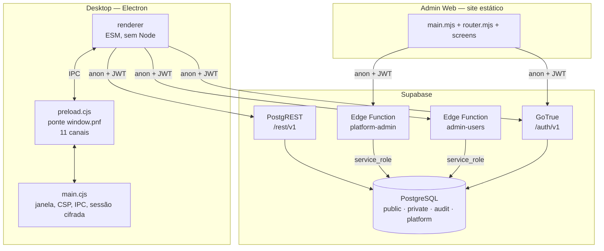
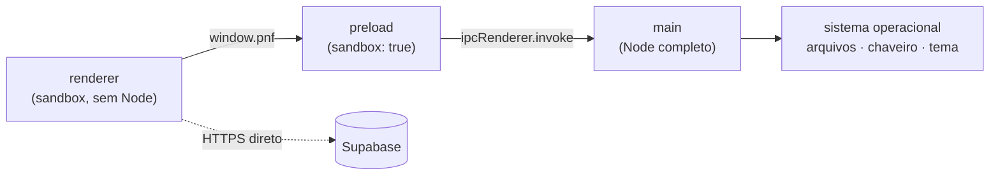
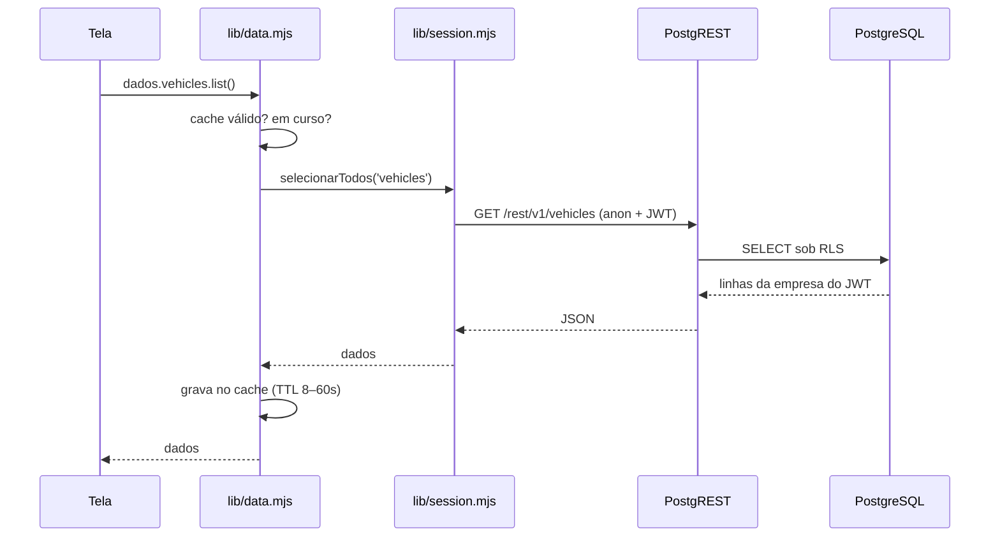
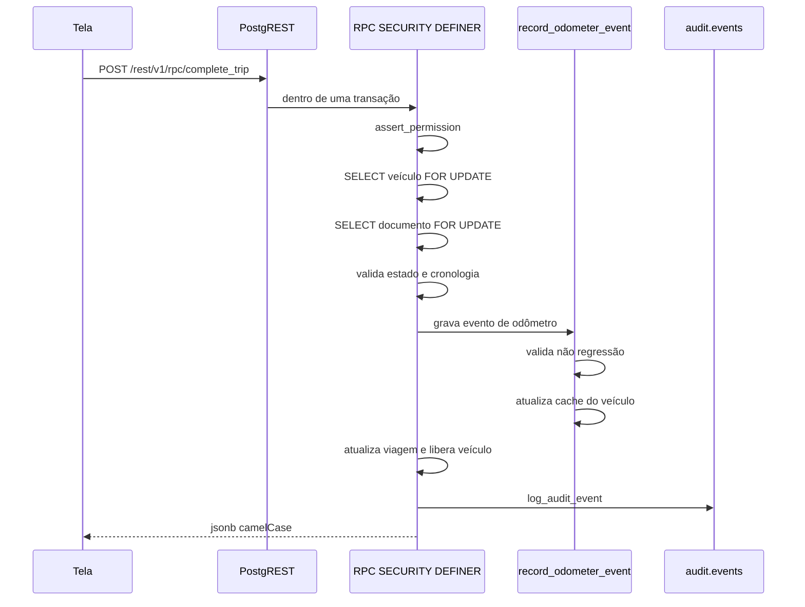
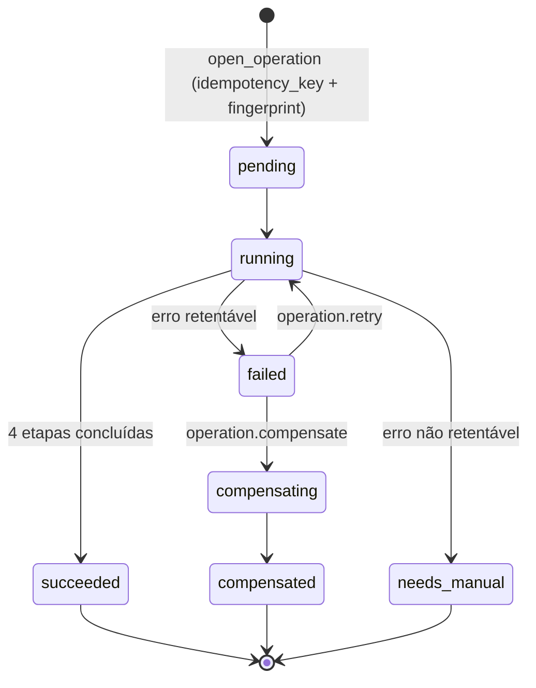

> Referência anterior à reorganização. As regras de produto podem continuar válidas, mas os caminhos e a divisão do código devem ser conferidos no `GUIA_DO_PROJETO.md` da raiz e no código atual.

# Arquitetura

Arquitetura **como implementada**, verificada contra o código. Onde a
documentação anterior descreve algo que não existe, o fato está registrado em
[Divergências](#8-divergências-com-a-documentação-anterior).

---

## 1. Visão geral

Duas aplicações cliente e um backend Supabase. **Não existe servidor Node
próprio**: a lógica de negócio vive em RPCs PostgreSQL, e as operações que
exigem privilégio ou segredo vivem em Edge Functions.



### Fronteira central

O Admin Web **não** possui caminho até os dados de frota. Isso é imposto em três
níveis:

1. o schema `platform` só tem `USAGE` para `service_role`;
2. o Admin Web nunca chama `/rest/v1` — apenas `/auth/v1` e a Edge Function;
3. `platform.get_company` não devolve veículo, viagem nem custo.

Ver [ADR-011](DECISOES_ATUAIS.md#decisao-011--camada-de-plataforma-e-dois-eixos-de-identidade).

---

## 2. Componentes

| Componente | Tecnologia | Responsabilidade |
|---|---|---|
| `apps/company-desktop` | Electron 43 | operação da frota pelas empresas |
| `apps/platform-admin-web` | HTML/CSS/JS estático | administração da plataforma |
| `packages/contracts` | ESM | permissões, papéis, erros, rótulos pt-BR |
| `packages/validation` | ESM | validação de entrada + importação XLSX/CSV |
| `supabase/migrations` | SQL | schema, RLS, triggers, RPCs — 49 arquivos |
| `supabase/functions/platform-admin` | Deno/TS | única porta privilegiada do Admin Web |
| `supabase/functions/admin-users` | Deno/TS | gestão da equipe da empresa, a partir do Desktop |
| `scripts/` | Node/Bash | build, gate, verificações, bootstrap, seed |

---

## 3. Camadas

### 3.1 Electron — três processos, uma ponte



**Main** (`src/sistema/abrir-janela.cjs`) — resolve configuração em cascata (variáveis de
ambiente → `config.json` em quatro caminhos → `.env` em três caminhos), monta a
CSP a partir da origem do Supabase, aplica hardening de sessão, registra os
canais IPC e cifra a sessão com `safeStorage`.

Hardening aplicado, em ordem de importância:

- `contextIsolation: true`, `sandbox: true`, `nodeIntegration: false`;
- `setPermissionRequestHandler`, `setPermissionCheckHandler` e
  `setDevicePermissionHandler` **sempre negam**;
- `onBeforeRequest` **cancela toda requisição** cujo destino não seja
  `file:`, `devtools:`, `blob:`, `data:` ou a origem do Supabase configurada;
- `will-navigate` bloqueia navegação fora de `file:`;
- `setWindowOpenHandler` nega e abre externamente apenas `https:` e `mailto:`;
- `certificate-error` sempre rejeita;
- `devTools` só em desenvolvimento (`PNF_DEV=1`).

**Preload** (`src/main/preload.cjs`) — expõe `window.pnf` com: `getConfig`,
`getAppInfo`, `getTheme`, `setTheme`, `getWindowState`, `exportFile`,
`openExternal`, `session.{save,load,clear}`, `getConfigStatus`.

> Como o preload roda com `sandbox: true`, ele **não pode** carregar módulos
> CommonJS locais. Os nomes dos canais são duplicados de propósito entre
> `preload.cjs` e `ipc-channels.cjs`; `ferramentas/verificacoes/verificar-electron.mjs`
> confere que continuam sincronizados.

**Renderer** — ESM puro, sem acesso a Node. Fala HTTPS diretamente com o
Supabase usando a chave anônima e o JWT do usuário.

### 3.2 Renderer do Desktop

```
main.mjs        NAV, rotas, login, shell, ciclo de inicialização
lib/session.mjs configuração, sessão, requisitar(), rpc(), contexto, conectividade
lib/data.mjs    camada de dados: cache, invalidação, paginação, todas as RPCs
lib/ui.mjs      componentes, roteador, estados de carregamento/erro/vazio
lib/icons.mjs   sprite SVG
screens/        index.mjs · analise.mjs · importacao.mjs
styles/         tokens.css + app.css
```

Toda tela recebe `{ outlet, setTitle, params, query }` e passa por um helper
comum que aplica: verificação de permissão → esqueleto → carregamento → render
ou estado de erro com botão de repetir.

**Cancelamento de resultado obsoleto:** cada carregamento marca
`outlet.__pnfLoadToken`. Se o usuário navegar antes do término, o resultado é
descartado em vez de sobrescrever a tela nova.

### 3.3 Admin Web

```
main.mjs        login, bootstrap, rotas
router.mjs      roteador por hash + shell (navegação, atalhos, banner)
lib/api.mjs     sessão, chamar(), objeto api, acompanharOperacao()
components/     base.mjs (componentes), scope.mjs, icons.mjs
screens/        index.mjs (todas as telas) + invite.mjs
boot-guard.js   converte falha de carregamento de módulo em mensagem útil
```

Configuração injetada em build dentro de `<script id="pnf-admin-config">`; a CSP
é escrita no HTML pelo próprio build.

### 3.4 Banco — quatro schemas

| Schema | Conteúdo | `db.schemas`? | Grants |
|---|---|:--:|---|
| `public` | 13 tabelas, 7 views, ~60 RPCs | ✅ | `authenticated`, seletivo |
| `private` | helpers, `permissions`, `role_permissions`, triggers | ❌ | nenhum a papéis de API |
| `audit` | `events` (append-only) | ❌ | leitura via `public.audit_events` |
| `platform` | 6 tabelas, ~40 RPCs | ✅ | **apenas** `service_role` |

> `platform` é endereçável pelo PostgREST porque a Edge Function o consome via
> `supabase-js`. A segurança não vem da invisibilidade: `anon` e `authenticated`
> não têm `USAGE` no schema nem `EXECUTE` nas funções — para eles o endereço
> existe e não leva a lugar nenhum.

Detalhes em [`BANCO_DE_DADOS.md`](BANCO_DE_DADOS.md).

---

## 4. Fluxo de dados

### 4.1 Leitura



O cache é **por chave derivada dos filtros**, com deduplicação de requisições em
voo. Toda mutação chama `executarMutacao(...)`, que invalida por prefixo os
grupos afetados (`vehicles`, `dashboard`, `yard`…).

Históricos grandes são paginados em lotes de até 4 requisições concorrentes,
com teto de 50.000 linhas por consulta.

### 4.2 Escrita transacional



Qualquer exceção desfaz tudo. A ordem *veículo → documento* é a mesma em todas as
RPCs ([ADR-014](DECISOES_ATUAIS.md#decisao-014--ordem-de-locks-padronizada)).

### 4.3 Operação administrativa

Provisionar uma empresa toca **dois sistemas**: PostgreSQL e GoTrue. Não existe
transação que cubra os dois — GoTrue é escrito por HTTP, fora do banco. Falha
parcial é possível por construção, e a resposta é registrar progresso e permitir
compensar ou retentar.



Idempotência em duas camadas: `idempotency_key` única **e** `fingerprint`
(SHA-256 do payload). Mesma chave com payload diferente é **erro**, não replay —
sem isso, reusar a chave por engano devolveria silenciosamente a empresa errada.

---

## 5. Comunicação entre componentes

| Origem | Destino | Protocolo | Autenticação |
|---|---|---|---|
| renderer | main | IPC (`invoke`) | lista fechada de canais |
| Desktop | GoTrue | HTTPS `/auth/v1` | anon key |
| Desktop | PostgREST | HTTPS `/rest/v1` | anon key + `Bearer` JWT |
| Desktop | `admin-users` | HTTPS `/functions/v1` | anon key + JWT + `Idempotency-Key` |
| Admin Web | GoTrue | HTTPS `/auth/v1` | anon key |
| Admin Web | `platform-admin` | HTTPS `/functions/v1` | anon key + JWT + `x-request-id` |
| Edge Function | PostgreSQL | `supabase-js` | `service_role` |
| RPC | RPC | SQL | contexto da transação |

**Renovação de sessão:** um `401` dispara `tryRefresh()`, que renova o token e
repete a requisição uma vez. Chamadas concorrentes compartilham a mesma promessa
de renovação. Falhando, a sessão é limpa e o login reaparece.

**Idempotência do Desktop:** cada chamada a `admin-users` gera um cabeçalho
`Idempotency-Key` novo em `funcaoEdge()`. Ele protege contra duplo envio da
mesma interação, não contra repetição intencional.

---

## 6. Serviços e processos

### 6.1 Externos

| Serviço | Uso | Detalhe |
|---|---|---|
| Supabase PostgreSQL | dados e regra de negócio | [`BANCO_DE_DADOS.md`](BANCO_DE_DADOS.md) |
| Supabase GoTrue | autenticação | senha ≥ 12, signup público desligado |
| Supabase PostgREST | API do tenant | `max_rows = 1000` |
| Supabase Edge Functions | operações privilegiadas | Deno |
| Relay SMTP | entrega de convite | opcional; `INVITE_DELIVERY=log` em dev |

Contratos em [`INTEGRACOES.md`](INTEGRACOES.md).

### 6.2 Assíncronos

**Não há filas, workers ou cron jobs.** Toda operação é síncrona dentro da
requisição.

Os três comportamentos que *parecem* assíncronos:

1. **Polling de operação** — `acompanharOperacao()` consulta `operation.get` com
   backoff (600 ms × 1,4, teto 4 s) até estado terminal.
2. **Sondagem de conectividade** — `GET /auth/v1/health` com timeout de 4,5 s;
   duas falhas consecutivas para exibir o aviso, uma resposta HTTP qualquer para
   removê-lo ([ADR-015](DECISOES_ATUAIS.md#decisao-015--conectividade-por-sondagem-de-saude)).
3. **Revalidação de permissões** — no evento `focus` da janela, `my_context()` é
   recarregado; se as permissões mudaram, a interface é remontada.

Realtime e Storage estão **desabilitados** em `supabase/config.toml`.

---

## 7. Pontos críticos

| Ponto | Risco | Proteção |
|---|---|---|
| `private.record_odometer_event` | corromper a quilometragem de toda a frota | única porta de escrita; lock; validação de não regressão; trigger em `vehicles` |
| `register_vehicle_movement` | quebrar a alternância entrada/saída | lock + índice único `(vehicle_id, sequence_no)` + check de paridade |
| `private.current_membership()` | vazamento entre empresas | `SECURITY DEFINER`; exige perfil, vínculo e empresa ativos; base de toda policy |
| `preload.cjs` | expor Node ao renderer | lista fechada; `sandbox: true`; verificador dedicado |
| `platform-admin/index.ts` | uso indevido de `service_role` | `verify_jwt` no gateway + revalidação do papel global a cada chamada + registro de negativas |
| `supabase/config.toml` `db.schemas` | expor `private`/`audit` | teste de consistência de configuração |
| `packages/contracts` | divergir do banco | `test:contracts` |

---

## 8. Divergências com a documentação anterior

Registradas para não serem redescobertas:

| Divergência | Situação real |
|---|---|
| `documentacao/historico/desenho-original/ARCHITECTURE.md` descreve o sistema em tempo futuro e propõe `src/renderer/features/<modulo>/` com `api/`, `state/`, `routes` | A estrutura real é `screens/` + `lib/`. Nunca houve módulos verticais. |
| ARCHITECTURE.md §10 descreve worker OCR local supervisionado pelo main | **Não existe.** Nenhum código de worker no main process. |
| ARCHITECTURE.md §14 cita Electron Forge | `package.json` declara `electron-builder`, e **nenhum script de empacotamento existe**. Não identificado qual será usado. |
| ARCHITECTURE.md §4.1 cita biblioteca de gráficos e de validação de schemas | Não há dependência de gráficos; a validação é própria (`packages/validation`). |

Os blueprints originais foram preservados em `docs/architecture/` para rastreabilidade; notas de versão ficam em `docs/historico/`.
