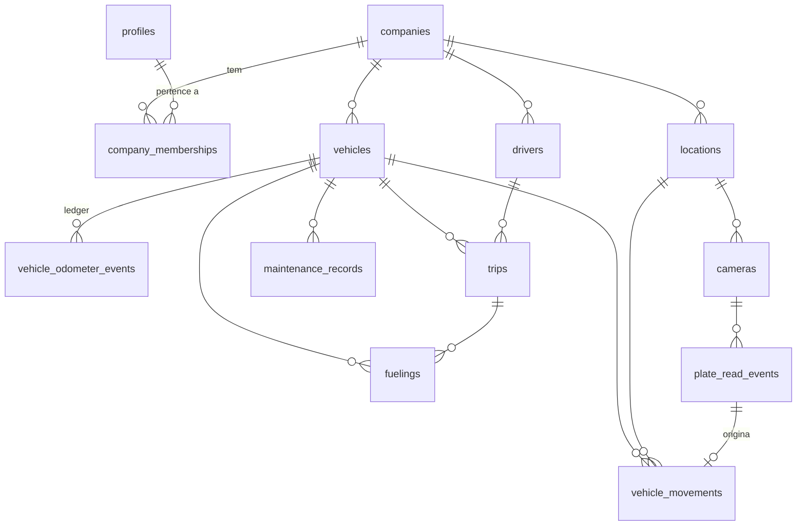
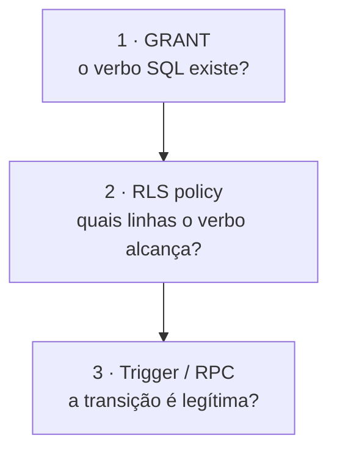

> Referência anterior à reorganização. As regras de produto podem continuar válidas, mas os caminhos e a divisão do código devem ser conferidos no `GUIA_DO_PROJETO.md` da raiz e no código atual.

# Banco de dados

PostgreSQL 15 no Supabase. **É aqui que a maior parte da regra de negócio vive.**
Uma regra que você não encontrar no JavaScript provavelmente está em SQL.

- 49 migrations em `supabase/migrations/`
- 13 tabelas em `public`, 6 em `platform`, 1 em `audit`, 2 em `private`
- 7 views, ~74 triggers, ~100 RPCs
- 17 arquivos de teste pgTAP

---

## 1. Schemas

| Schema | Papel | Na API? |
|---|---|:--:|
| `public` | tabelas de negócio, views e RPCs do tenant, sempre sob RLS | ✅ |
| `private` | helpers, catálogo de permissões, funções de trigger | ❌ |
| `audit` | trilha append-only de negócio | ❌ |
| `platform` | camada global da plataforma | ✅ (só `service_role`) |
| `extensions` | `pgcrypto` | — |

`private` e `audit` são explicitamente revogados de `public`, `anon` e
`authenticated` já na primeira migration. `audit.events` é lido pela view
`public.audit_events`, com `security_invoker`.

---

## 2. Modelo de dados — tenant



**Toda tabela de negócio carrega `company_id`**, mesmo quando ele poderia ser
derivado pelo veículo. Essa redundância é deliberada: torna a policy RLS direta,
melhora os índices, evita joins ambíguos e permite validar que todos os
relacionamentos de uma linha pertencem à mesma empresa.

### 2.1 Tenancy

**`companies`** — o tenant.

| Coluna | Nota |
|---|---|
| `cnpj` | único **globalmente**, formato `^[0-9]{14}$`, validado por módulo 11 (`private.is_valid_cnpj`) |
| `status` | `active` \| `suspended` \| `archived` — os dois últimos **removem o acesso de todos os usuários da empresa** |
| `timezone` | default `America/Sao_Paulo`; usado no recorte mensal dos relatórios |
| `archived_at` / `archived_by` | consistência garantida por check |

**`profiles`** — espelho mínimo de `auth.users`. Nunca guarda senha, token ou
identidade externa. `active = false` bloqueia a RLS imediatamente.

> Desde `20260731000100`, a **empresa não administra mais `profiles.active`**.
> O acesso empresarial vive exclusivamente em `company_memberships.active`.
> `profiles.active` é operação privilegiada, e o usuário só pode alterar
> `full_name` e `phone` do próprio perfil — imposto por **grant de coluna**, não
> por policy.

**`company_memberships`** — vínculo usuário↔empresa. Índice único parcial
`(user_id) WHERE active` garante no máximo um vínculo ativo por usuário.

### 2.2 Frota

**`vehicles`**

| Garantia | Como |
|---|---|
| placa única globalmente | `unique (plate)` |
| formato de placa | check: `AAA0000` ou `AAA0A00`, sempre normalizada por trigger |
| ano do modelo ≥ ano de fabricação | check |
| `current_odometer_km` é cache | trigger `tg_vehicle_odometer_guard` bloqueia escrita direta |
| arquivamento consistente | `archived_at` ⟺ `status = 'archived'` |

**`vehicle_odometer_events` — o ledger** ([ADR-006](../adr/ADR-006-odometer-ledger.md))

| Coluna | Papel |
|---|---|
| `odometer_km` / `previous_km` | check `odometer_km >= previous_km` |
| `source_type` | `vehicle_registration` \| `trip_completion` \| `fueling` \| `maintenance_completion` \| `manual_adjustment` |
| `source_id` | obrigatório exceto em cadastro e ajuste manual |
| `reason` | obrigatório em ajuste manual |
| `correction_of_id` | evento compensatório; único caminho para retrodatar |

Índice único `(source_type, source_id) WHERE source_id is not null` — é o que
torna as RPCs transacionais idempotentes. `UPDATE` e `DELETE` são bloqueados por
trigger.

**`drivers`** — sem login. Documento interno único por empresa entre os não
arquivados. Categoria de CNH restrita a um conjunto fechado.

### 2.3 Operação

**`trips`** — coerência por estado imposta por quatro checks:

| Estado | Exigência |
|---|---|
| `planned` | sem datas reais, sem quilometragens |
| `in_progress` | saída e km inicial preenchidos; retorno e km final nulos |
| `completed` | todos os quatro preenchidos |
| `cancelled` | `cancelled_at` e motivo normalizado |

Índice único `(vehicle_id) WHERE status = 'in_progress'` — um veículo não tem
duas viagens em andamento.

**`fuelings`** — a constraint que define o produto:

```sql
constraint fuelings_total_exact
  check (total_amount = round(liters * price_per_liter, 2))
```

Total divergente é **impossível de gravar por qualquer caminho**. `liters` é
`numeric(12,3)` e `total_amount` é `money_brl` (`numeric(14,2)`); nunca ponto
flutuante.

**`maintenance_records`** — agendamento e histórico no mesmo modelo, separados
por estado. `completed` exige `total_cost > 0`. Data futura só em `scheduled`
(trigger de cronologia). Índice parcial garante no máximo uma manutenção em
andamento por veículo.

### 2.4 Acesso físico

**`locations`** — nome único por empresa entre os não arquivados.

**`cameras`** — a coluna `settings` é validada para **nunca conter credenciais**:

```sql
constraint cameras_settings_no_secrets check (
  not (settings ?| array['password','passwd','secret','token','api_key',
       'apiKey','credentials','rtsp_url','rtspUrl','private_key','authorization'])
)
```

`min_confidence` (default `0.80`, faixa `0.50`–`1.00`) é **configuração do
servidor**, alterável só por quem administra câmeras. Foi movida para cá porque
antes o cliente podia enviar o próprio limiar.

**`plate_read_events`** — entrada não confiável. Checks garantem que apenas
`confirmed` aponta veículo, que `unknown_plate` não aponta nenhum e que
`duplicate` referencia a leitura de origem. Índice único
`(company_id, client_event_id)` dá idempotência ao dispositivo.

**`vehicle_movements`** ([ADR-007](../adr/ADR-007-atomic-movement-registration.md))

```sql
constraint movements_first_is_entry
  check (sequence_no > 1 or movement_type = 'entry'),
constraint movements_alternation_parity check (
  (sequence_no % 2 = 1 and movement_type = 'entry')
  or (sequence_no % 2 = 0 and movement_type = 'exit')
)
```

Com o índice único `(vehicle_id, sequence_no)`, a alternância é
**estruturalmente impossível de violar** — nem por bug, nem por concorrência.
`occurred_at` é sempre carimbo do servidor.

### 2.5 Auditoria de negócio

`audit.events` guarda empresa, ator, ação, entidade, campos alterados,
`request_id` e metadados. O trigger genérico `private.tg_audit()`:

- registra **apenas campos alterados**, no formato `{campo: {old, new}}`;
- ignora `updated_at`, `created_at`, `last_seen_at`;
- não grava nada quando só houve ruído de timestamp;
- promove a ação para `archive`/`unarchive` quando `archived_at` muda.

`UPDATE` e `DELETE` são bloqueados por trigger **para todos os papéis, inclusive
o dono**.

---

## 3. Modelo de dados — plataforma

| Tabela | Papel |
|---|---|
| `platform.admins` | papel global; `status` é **ortogonal** a `company_memberships.active` |
| `platform.operations` | operação durável com `idempotency_key` única e `fingerprint` SHA-256 |
| `platform.operation_steps` | as 4 etapas exibidas na barra de progresso |
| `platform.audit_events` | trilha global, incluindo negativas |
| `platform.bootstrap_tokens` | token efêmero do primeiro administrador |
| `platform.company_invites` | convites (mantido por compatibilidade — ver [ADR-012](DECISOES_ATUAIS.md#decisao-012--primeiro-administrador-com-senha-direta)) |

Constraints notáveis em `operations`: estado terminal exige `finished_at`;
código de erro só existe em estados de falha; `retryable = true` só em `failed`
ou `compensated`.

`platform.audit_events.actor_user_id` **não tem FK** de propósito: uma FK com
`ON DELETE SET NULL` tentaria `UPDATE` numa trilha append-only. O UUID histórico
é preservado sem vínculo físico.

---

## 4. Segurança em três camadas



**A primeira camada é a mais importante.** Para `vehicle_odometer_events`,
`vehicle_movements`, `plate_read_events` e o `INSERT` de `fuelings`, o
privilégio **simplesmente não é concedido** a `authenticated`. Não existe policy
a contornar: o caminho é a RPC `SECURITY DEFINER` ou nada.

### 4.1 Princípios das policies

1. Toda tabela exposta tem RLS habilitada.
2. Policies separadas por operação.
3. Nenhuma policy confia no `company_id` do cliente — sempre
   `private.current_user_company_id()`.
4. Perfil **e** vínculo **e** empresa precisam estar ativos; caso contrário a
   função devolve `NULL`, e `company_id = NULL` nunca é verdadeiro.
5. Chamadas a helpers são embrulhadas em `(select ...)` para virarem InitPlan e
   serem avaliadas uma vez por consulta, não uma vez por linha.
6. `DELETE` é negado por **ausência de policy** em toda tabela histórica.

### 4.2 Resumo por tabela

| Tabela | SELECT | INSERT | UPDATE | DELETE |
|---|---|---|---|---|
| `companies` | `company.read` | — | `company.update` | — |
| `profiles` | próprio ou `users.read` | — | próprio (2 colunas) ou `users.manage` | — |
| `company_memberships` | próprio ou `users.read` | `users.manage` | `users.manage` | `users.manage` |
| `drivers` | `drivers.read` | `drivers.write` | `drivers.write` | — |
| `vehicles` | `vehicles.read` | `vehicles.write` | `vehicles.write` | — |
| `vehicle_odometer_events` | `odometer.read` | **só RPC** | ❌ | ❌ |
| `trips` | `trips.read` | `trips.write` (só `planned`) | `trips.write` | — |
| `fuelings` | `fuelings.read` | **só RPC** | `fuelings.write` | — |
| `maintenance_records` | `maintenance.read` | `maintenance.schedule`/`write` | `maintenance.write` | — |
| `locations` | `locations.read` | `locations.write` | `locations.write` | `company_admin` |
| `cameras` | `cameras.read` | `cameras.write` | `cameras.write` | `company_admin` |
| `plate_read_events` | `ocr.read` | **só RPC** | ❌ | ❌ |
| `vehicle_movements` | `movements.read` | **só RPC** | ❌ | ❌ |
| `audit.events` | `audit.read` | **só função** | ❌ | ❌ |

`DELETE` em `locations` e `cameras` é permitido apenas ao `company_admin` — e as
FKs `on delete restrict` de `vehicle_movements` bloqueiam qualquer local com
histórico.

### 4.3 Catálogo de permissões

A matriz papel×permissão é **materializada em tabela** (`private.permissions` e
`private.role_permissions`), não codificada em JavaScript. Isso permite testá-la,
auditá-la e consultá-la pela interface sem duplicar regra.

`packages/contracts` **espelha** esse catálogo. Alterar uma permissão exige
mudar os dois.

> **Divergência conhecida:** `private.permissions` contém `cameras.read`,
> `cameras.write`, `ocr.read` e `ocr.operate`, que **não** estão em
> `PERMISSAO` no pacote `contracts`. O banco é a fonte de verdade.

### 4.4 Helpers de identidade

Todos em `private`, todos `SECURITY DEFINER` — obrigatoriamente, porque as
policies de `company_memberships` os invocam e um `SECURITY INVOKER` causaria
recursão infinita de RLS.

| Função | Devolve |
|---|---|
| `current_user_id()` | `auth.uid()` |
| `current_membership()` | `(company_id, role)` exigindo perfil, vínculo **e** empresa ativos |
| `current_user_company_id()` / `current_user_role()` | derivados do anterior |
| `has_permission(text)` / `current_permissions()` | permissões do papel |
| `assert_company_access(uuid)` / `assert_permission(text)` | lançam `TENANT_MISMATCH` / `PERMISSION_DENIED` |
| `is_platform_admin(uuid)` | papel global ativo **e** perfil ativo |

`private.is_api_role()` é a exceção: **precisa** ser `SECURITY INVOKER`, porque
distingue "escrita direta do cliente" de "escrita dentro de uma RPC autorizada"
pelo papel efetivo (`anon`/`authenticated`/`service_role` vs. dono da função).
A distinção não usa GUC, que seria falsificável em tese.

---

## 5. Triggers relevantes

| Trigger | Efeito |
|---|---|
| `tg_normalize_*` | normalizam placa, CNPJ, telefone, CEP, rótulos **antes** dos checks |
| `tg_vehicle_odometer_guard` | bloqueia escrita direta em `current_odometer_km` |
| `tg_odometer_ledger_insert` | valida cronologia; retrodatação só como correção |
| `tg_trip_status_guard` / `tg_maintenance_status_guard` | fecham transições de estado |
| `tg_vehicle_state_guard` / `tg_driver_state_guard` / `tg_company_state_guard` | impedem que o cliente altere estado fora da RPC |
| `tg_fueling_consistency` / `tg_fueling_core_immutable` | compatibilidade de combustível; campos centrais imutáveis |
| `tg_actor_integrity` | valida que todo campo de ator pertence à empresa da linha |
| `tg_protect_last_admin` / `tg_protect_last_admin_profile` | piso de administradores da empresa |
| `platform.tg_protect_last_platform_admin` | piso de administradores da plataforma |
| `tg_forbid_mutation` / `tg_forbid_update_delete` | append-only |
| `tg_audit` | trilha genérica |
| `tg_set_updated_at` | carimbo de atualização |

> **Nota de projeto:** CNPJ, placa e UF **não** usam `domain`. Um domain é
> validado na coerção do valor de entrada, ou seja **antes** de qualquer trigger
> `BEFORE` — o que tornaria a normalização inútil (`11.222.333/0001-81` seria
> recusado antes de virar `11222333000181`). Essas colunas usam `text` + `CHECK`
> na tabela, avaliado **depois** do trigger.

---

## 6. Domains e enums

**Domains:** `money_brl numeric(14,2)`, `liters numeric(12,3)`,
`odometer_km numeric(12,1)`, `confidence_score numeric(5,4)`.

**Enums principais:** `company_status`, `membership_role`, `vehicle_status`,
`fuel_type`, `odometer_source_type`, `trip_status`, `maintenance_type`,
`maintenance_status`, `camera_direction`, `plate_read_status`, `movement_type`,
`movement_source`, `audit.event_action`, e os enums de `platform`.

`fuel_type` mistura **motorização** (`flex`, `electric`) e **produto de bomba**.
A decisão foi manter um único enum e separar o significado por coluna com
constraint explícita — criar um segundo enum obrigaria a reescrever FKs, views e
contratos de RPC sem ganho real.

---

## 7. Views

Todas com `security_invoker = true`: a RLS das tabelas base é aplicada com a
identidade de quem consulta. **Uma view nunca é caminho de escape do tenant.**
Nenhuma materialized view.

| View | Conteúdo |
|---|---|
| `v_vehicle_presence` | estado atual de presença por veículo |
| `v_fleet_status_summary` | contagem da frota por estado |
| `v_vehicle_monthly_costs` | combustível + manutenção por veículo e mês, no fuso da empresa |
| `v_vehicle_fuel_consumption` | consumo médio, **apenas** por ciclos de tanque cheio |
| `v_maintenance_due` | manutenções vencidas e próximas |
| `v_recent_movements` | timeline de movimentações |
| `audit_events` | leitura de `audit.events` a partir de `public` |

---

## 8. Índices que importam

| Índice | Por quê |
|---|---|
| `company_memberships_one_active_per_user_idx` | garante a regra "um usuário, uma empresa" |
| `movements_vehicle_sequence_idx` | garante a alternância sob concorrência |
| `movements_plate_read_unique_idx` | uma leitura OCR gera no máximo uma movimentação |
| `odometer_events_source_unique_idx` | idempotência das RPCs transacionais |
| `trips_one_in_progress_per_vehicle_idx` | uma viagem em andamento por veículo |
| `plate_read_client_event_idx` | idempotência do dispositivo OCR |
| `platform_operations_idempotency_idx` | uma empresa por chave de idempotência |
| `vehicles_plate_unique` | placa única globalmente |
| `drivers_company_document_idx` | documento único por empresa (parcial) |
| `locations_company_name_idx` | nome de local único por empresa (parcial) |

Os demais índices seguem o padrão `(company_id, <tempo> desc)` para sustentar
listagens e relatórios.

---

## 9. Migrations

Ordenadas por `AAAAMMDDHHMMSS_assunto.sql`.

| Bloco | Conteúdo |
|---|---|
| `20260729000100`–`002300` | modelo base: schemas, enums, helpers, tabelas, auditoria, triggers, RLS, grants, RPCs, views, hardening |
| `20260731000100`–`000900` | correções da primeira e segunda auditoria de banco (`DB-AUD-*`) |
| `20260802000100`–`000800` | camada `platform` |
| `20260804000100` | RPCs de cadastro que faltavam ao Desktop |
| `20260808000100`–`000300` | instalação limpa, completude de produto, refresh do PostgREST |
| `20260812000100`–`000200` | senha direta no provisionamento; exclusão definitiva e gestão de usuários |

**Regra:** migration publicada **não é reescrita**. Correção entra em migration
nova, para manter a evolução auditável.

---

## 10. Autotestes

```sql
select * from private.security_selftest();
select * from private.data_integrity_selftest();
```

Ambas devolvem **uma linha por problema encontrado**. Resultado vazio significa
"nenhum desvio detectado". São o primeiro diagnóstico depois de qualquer
`db push` — ver [`IMPLANTACAO.md`](IMPLANTACAO.md) e
[`SOLUCAO_DE_PROBLEMAS.md`](SOLUCAO_DE_PROBLEMAS.md).

---

## 11. Seed

`supabase/seed.sql` cria empresas, usuários, veículos, motoristas, locais,
viagens, abastecimentos, manutenções, movimentações e auditoria fictícios.

Propriedades: IDs derivados de `private.stable_uuid()`, variação de
`private.stable_random()` — **sem `random()` real**; idempotente (não faz nada se
já existem empresas); cronologia e quilometragem coerentes por veículo; timeline
terminando "agora", para que dashboards nunca apareçam vazios. CNPJs fictícios,
porém válidos no módulo 11.

**O seed não cria `platform_admin`.** O papel global é sempre provisionado
separadamente pelo bootstrap.

Contas e volumes de demonstração: `documentacao/banco-de-dados/SEED_GUIDE.md` (documento
original preservado).

---

## 12. Dados que exigem cuidado

| Dado | Cuidado |
|---|---|
| `vehicle_odometer_events` | imutável. Erro se corrige com **evento de correção**, nunca com `UPDATE`. |
| `vehicle_movements` | imutável. Apagar uma linha quebra a paridade de toda a sequência seguinte. |
| `audit.events` / `platform.audit_events` | append-only. Não existe caminho legítimo de alteração. |
| `platform.operations.actor_user_id` | aceita `NULL` de propósito, para não travar a exclusão de identidade antiga. **Nunca substitua por outro UUID** — isso adultera autoria. |
| `companies.cnpj` | único globalmente. Alterar afeta idempotência de provisionamento. |
| `vehicles.current_odometer_km` | cache. Alterar direto dessincroniza do ledger. |
| `private.role_permissions` | alterar muda o acesso de todos os usuários daquele papel imediatamente. |
| `platform.admins` | o último ativo é protegido por trigger; use `platform:replace`. |

---

## 13. Referências

- Contratos de RPC → [`API.md`](API.md)
- Regras e onde são impostas → [`REGRAS_DE_NEGOCIO.md`](REGRAS_DE_NEGOCIO.md)
- Aplicar migrations e seed → [`IMPLANTACAO.md`](IMPLANTACAO.md)
- Rodar pgTAP → [`DESENVOLVIMENTO.md`](DESENVOLVIMENTO.md)
- Documentos originais preservados: `documentacao/banco-de-dados/DATABASE_SCHEMA.md`,
  `RLS_MATRIX.md`, `RPC_CONTRACTS.md`, `AUDIT_FIXES.md`, `SEED_GUIDE.md`
