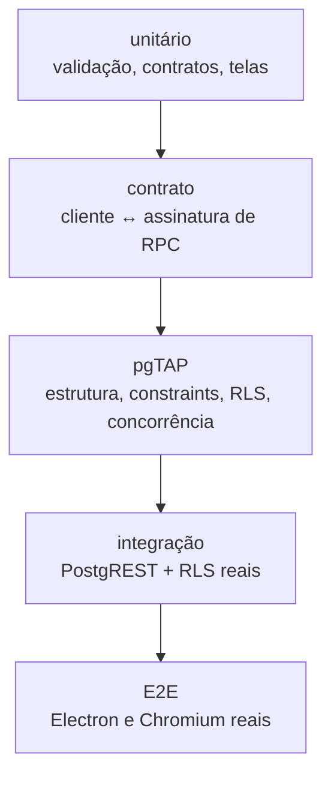

> Referência anterior à reorganização. As regras de produto podem continuar válidas, mas os caminhos e a divisão do código devem ser conferidos no `GUIA_DO_PROJETO.md` da raiz e no código atual.

# Desenvolvimento

Como trabalhar neste projeto.

---

## 1. Pré-requisitos

| Item | Versão | Necessário para |
|---|---|---|
| Node.js | **≥ 22** | tudo |
| npm | qualquer com workspaces | tudo |
| Supabase CLI | recente | migrations, deploy, ambiente local |
| PostgreSQL + pgTAP + `pg_prove` | 16 | `npm run db:test` |
| `psql` | — | smoke SQL direto |
| Chromium/Playwright | — | E2E do Admin Web |

Sem PostgreSQL local o projeto continua utilizável: as etapas de banco são
reportadas como **N/E**, não como falha.

---

## 2. Instalação

```bash
npm ci                                # instala exatamente o lockfile
cp .env.example .env                  # PowerShell: Copy-Item .env.example .env
```

Preencha em `.env`:

```env
PNF_SUPABASE_URL=https://<ref>.supabase.co
PNF_SUPABASE_ANON_KEY=<chave anônima>
```

Os dois valores estão no painel do Supabase, em *Project Settings → API*
(*Project URL* e *anon public*).

> A chave anônima é pública por natureza: identifica o projeto e não autoriza
> nada. **Nunca** use `service_role` aqui.

`npm ci` instala também o driver PostgreSQL usado pelos scripts de seed e
verificação remota.

---

## 3. Configuração local

Três caminhos, do mais completo ao mais leve:

| Caminho | Comando | O que é real |
|---|---|---|
| Supabase CLI | `npx supabase start` | tudo: Postgres, PostgREST, GoTrue, Edge Runtime |
| Harness próprio | `npm run dev:stack` | Postgres 16 + PostgREST 12 nativos, JWT emitido localmente |
| Projeto remoto | apenas `.env` | tudo real, dados compartilhados |

**Sobre o harness** (`ferramentas/desenvolvimento/pilha-local.sh`): sobe PostgreSQL e PostgREST
nativamente, sem Docker. É onde vivem os achados de contrato — a diferença entre
"o SQL funciona no `psql`" e "o cliente HTTP consegue chamar". O GoTrue **não** é
real: os JWTs são emitidos por `ferramentas/desenvolvimento/token-local.mjs` com o mesmo segredo e as
mesmas claims. Para o PostgREST e para a RLS o token é indistinguível; o que não
se exercita é o cadastro de senha e os fluxos próprios do GoTrue.

```bash
npm run dev:stack        # sobe
npm run dev:stack:down   # derruba
```

---

## 4. Como iniciar

```bash
npm run desktop          # compila e abre o Electron
npm run build:admin
npm run preview:admin    # Admin Web em http://localhost:5174
```

Em contêiner rodando como root, o Electron precisa de:

```bash
npm run desktop -- --no-sandbox
```

`npm run desktop` valida `.env`, compila, confere os artefatos e o binário do
Electron antes de abrir — cada falha tem mensagem própria com o comando de
correção.

---

## 5. Comandos

### Build
| Comando | Efeito |
|---|---|
| `npm run build` | admin + desktop |
| `npm run build:admin` / `build:desktop` | individual |
| `npm run preview:admin` | serve o Admin Web |
| `npm run desktop` | compila e abre o Electron |

### Testes
| Comando | Cobre |
|---|---|
| `npm run test:unit` | 24 arquivos em `packages/` e `apps/` |
| `npm run test:edge:unit` | handler de `admin-users` |
| `npm run test:contracts` | contrato Desktop ↔ banco |
| `npm run test:config` | consistência entre `config.toml`, `.env.example` e secrets |
| `npm run db:test` | pgTAP (17 arquivos) |
| `npm run db:reset` | recria o banco do harness |
| `npm run test:integration` | PostgREST + RLS reais |
| `npm run test:auth-real` | identidade e convite |
| `npm run test:edge:integration` | Edge Function no runtime Deno |
| `npm run smoke:admin` / `smoke:desktop` | fumaça |
| `npm run test:e2e` | Desktop + Admin Web |
| `npm run visual` | capturas e semelhança visual |

### Verificações
| Comando | Verifica |
|---|---|
| `npm run lint` | sintaxe, imports relativos, imports de workspace |
| `npm run verify:secrets` | segredo no repositório |
| `npm run verify:no-cdn` | asset remoto |
| `npm run verify:prototype` | artefato de protótipo |
| `npm run verify:boundaries` | fronteiras entre produtos |
| `npm run verify:electron` | hardening e sincronismo de canais IPC |
| `npm run report:counts` | contagens do projeto |

### Banco e operação
| Comando | Efeito |
|---|---|
| `npm run platform:bootstrap` | cria o primeiro administrador global |
| `npm run platform:replace` | transfere o papel global |
| `npm run seed:remote` | aplica o seed em projeto remoto |
| `npm run seed:verify` | valida volumes e invariantes |
| `npm run deploy:functions` | publica as duas Edge Functions |
| `npm run backend:verify` | confere contratos contra um backend real |

### Gate
```bash
npm run gate
```

---

## 6. Testes

### Camadas



### O que cada camada cobre

**Unitário** — `packages/validation` (CNPJ, placa, senha, importação XLSX/CSV) e as
telas dos dois produtos (permissões, navegação, regressão de UI, conectividade,
performance).

**Contrato** — confere que toda RPC chamada pelo cliente existe no banco com a
assinatura esperada. Pega a classe de erro mais comum: cliente novo, banco
antigo.

**pgTAP** — 17 arquivos cobrindo estrutura, constraints, permissões de
identidade, isolamento RLS, ledger, operações, OCR, auditoria, camada de
plataforma, convites e instalação limpa.

**Integração** — PostgREST real com RLS aplicada; inclui teste de concorrência
(foi ele que revelou as duas armadilhas da janela de deduplicação).

**E2E e visual** — especificados em `../operacao/E2E_SCENARIOS.md`, **nunca
executados**. O gate os reporta como N/E. Registro honesto: especificado ≠
aprovado.

### O que rodar depois de mudar o quê

| Mudou | Rode |
|---|---|
| JavaScript | `lint` + `test:unit` |
| tela ou componente | `build:desktop` / `build:admin` |
| migration | `db:test` + `test:contracts` |
| Edge Function | `test:edge:unit` |
| contrato cliente↔banco | `test:contracts` |
| configuração | `test:config` |
| antes de entregar | `gate` |

---

## 7. Lint

`ferramentas/verificacoes/analisar-codigo.mjs` é um verificador próprio — **não é ESLint**. Verifica:

- sintaxe, via `node --check`;
- imports relativos que não resolvem (`.mjs`, `.js`, `index.mjs`);
- imports de `@peganafrota/*` sem a dependência declarada no `package.json` do
  pacote;
- e demais regras estruturais do monorepo.

Formatação é responsabilidade do `.editorconfig`: UTF-8, LF, 2 espaços, sem
espaço à direita, nova linha ao final.

---

## 8. Convenções

### Idioma
Identificadores de **código em português** (`telaVeiculos`,
`carregarConfiguracao`, `dadosEnvio`); identificadores de **banco em inglês**
(`vehicles`, `register_fueling`). Alguns nomes em inglês sobrevivem no
JavaScript por compatibilidade — `screenDashboard` é alias exportado de
`telaPainel`.

### Arquivos
| Extensão | Onde |
|---|---|
| `.cjs` | main e preload do Electron |
| `.mjs` | todo o resto do JavaScript |
| `.ts` | Edge Functions |
| `.sql` | migrations e testes de banco |

### Banco
- Migrations: `AAAAMMDDHHMMSS_assunto.sql`, com cabeçalho explicando o **porquê**
  e citando os achados que corrige.
- Parâmetros de RPC com prefixo `p_`.
- RPC devolve `jsonb` em `camelCase`.
- Erro = `SQLSTATE` + `HINT`.
- Toda função com `search_path = ''` e objetos qualificados.

### Comentários
O código existente comenta **decisão**, não sintaxe. Exemplos reais:

> *"Duas proteções sutis, ambas encontradas por teste de concorrência real…"*
> *"Este preload roda com `sandbox: true`. Os nomes dos canais ficam repetidos
> aqui de propósito…"*

Mantenha esse padrão. Um comentário que explica `for` não ajuda ninguém; um que
explica por que a janela precisa de `greatest(..., 0)` evita uma regressão.

---

## 9. Estrutura esperada para novas funcionalidades

### Nova entidade de negócio

1. **Migration nova** com tabela, constraints, índices, RLS, grants e triggers.
2. **RPCs** de escrita com `assert_permission`, `assert_company_access`,
   auditoria e o padrão de lock.
3. **Permissões** em `private.permissions` e `private.role_permissions`.
4. **Espelhar** em `packages/contracts` (`PERMISSAO`, `ROTULO_PERMISSAO`).
5. **Validação** em `packages/validation`, se houver formulário.
6. **Camada de dados** em `lib/data.mjs`, com cache e invalidação.
7. **Tela** em `screens/`, usando o helper de permissão + carregamento.
8. **Rota e item de menu** em `main.mjs` (`NAV` e `registrarRotas`).
9. **Testes**: pgTAP para as invariantes, unitário para a validação.
10. **Documentar**: [`REGRAS_DE_NEGOCIO.md`](REGRAS_DE_NEGOCIO.md) e
    [`API.md`](API.md).

### Nova ação administrativa

1. RPC no schema `platform`.
2. Handler em `platform-admin/index.ts` + `HINT_TO_HTTP` se houver erro novo.
3. Método no objeto `api` de `lib/api.mjs`.
4. Tela, com confirmação explícita se for destrutiva.
5. Código de erro em `packages/contracts.ERRO_PLATAFORMA`.
6. Teste pgTAP + teste da Edge Function.

### Novo canal IPC

1. Nome em `ipc-channels.cjs`.
2. **O mesmo nome duplicado** em `preload.cjs` — o preload sandboxed não pode
   fazer `require()` local.
3. Handler em `main.cjs`, **com validação de entrada**.
4. `npm run verify:electron` para conferir o sincronismo.

---

## 10. Antes de abrir uma alteração

- [ ] `npm run lint` passa
- [ ] `npm run test:unit` passa
- [ ] os builds passam (validam imports nomeados e ausência de CDN)
- [ ] mudou migration? `npm run db:test` e `npm run test:contracts`
- [ ] mudou permissão? banco **e** `packages/contracts`
- [ ] **abriu o aplicativo de verdade?**

> O último item não é formalidade. Dois defeitos recentes — `telaImportacao is
> not defined` e um export inexistente em `ui.mjs` — passaram pelo build e só
> apareceram com o Electron aberto. **Compilar não basta.**

---

## 11. Armadilhas conhecidas

| Armadilha | Consequência |
|---|---|
| `require()` local no `preload.cjs` | `window.pnf` fica `undefined` |
| Renomear export sem atualizar quem importa | Admin Web preso em "Carregando…" |
| Editar migration já publicada | histórico deixa de ser auditável |
| Escrever em `current_odometer_km` | trigger bloqueia |
| Inverter a ordem de lock | deadlock sob concorrência |
| Adicionar permissão só no banco | interface não a reconhece |
| Adicionar permissão só em `contracts` | banco nega |
| Adicionar dependência de CDN | três verificadores falham |
| Duplicar um arquivo de telas | ver §12 |

---

## 12. Um caso que vale conhecer

`screens/v8.mjs` era uma **cópia inteira** de `screens/index.mjs`, com 802
linhas, que ninguém importava. O build já a apagava do artefato, então nunca
chegou ao cliente.

Não era inofensiva. A função `atividade` existia **apenas** na cópia; o arquivo
vivo a chamava sem definir — erro garantido ao abrir qualquer veículo. E quem
procurasse no repositório **encontrava a definição**, com a impressão de que
estava tudo certo.

Antes de apagar, foi verificado que o arquivo vivo satisfaz todas as asserções
que os 18 testes faziam contra a cópia. Os testes foram repontados para o
arquivo real, sem perda de cobertura: eles validavam código que não era
executado. Um teste novo impede o retorno da duplicata.

**Duas cópias divergindo é assim que esse erro nasce.**

---

## 13. Referências

- Mapa do sistema → [`README.md`](README.md)
- Arquitetura → [`ARQUITETURA.md`](ARQUITETURA.md)
- Banco → [`BANCO_DE_DADOS.md`](BANCO_DE_DADOS.md)
- API → [`API.md`](API.md)
- Deploy → [`IMPLANTACAO.md`](IMPLANTACAO.md)
- Problemas → [`SOLUCAO_DE_PROBLEMAS.md`](SOLUCAO_DE_PROBLEMAS.md)
