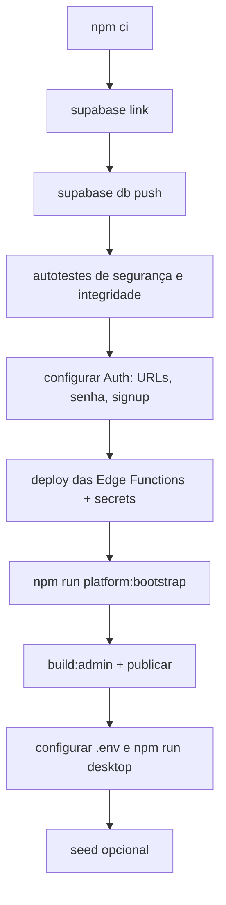

> Referência anterior à reorganização. As regras de produto podem continuar válidas, mas os caminhos e a divisão do código devem ser conferidos no `GUIA_DO_PROJETO.md` da raiz e no código atual.

# Implantação

Como o sistema é construído, configurado e publicado. Nenhum segredo real
aparece aqui.

---

## 1. Ambientes

| Ambiente | Backend | Desktop | Admin Web |
|---|---|---|---|
| Local | Supabase CLI (`54321`) ou harness PostgreSQL+PostgREST | `npm run desktop` | `npm run preview:admin` |
| Homologação | projeto Supabase próprio | build com `.env` de homologação | site estático |
| Produção | projeto Supabase próprio | build com `.env` de produção | site estático |

Não há infraestrutura própria — nem contêiner, nem orquestrador, nem servidor de
aplicação. O Admin Web é HTML/CSS/JS estático servível por qualquer host.

O Admin Web detecta o ambiente pelo hostname e exibe um selo: `LOCAL` para
`localhost`/`127.0.0.1`/`.local`, `HOMOLOGAÇÃO` para hostnames contendo
`staging`, `homolog`, `hml` ou `dev`, e `PRODUÇÃO` no restante.

---

## 2. Variáveis de ambiente

### 2.1 Build dos dois produtos — `.env` na raiz

| Variável | Descrição |
|---|---|
| `PNF_SUPABASE_URL` | URL do projeto (`https://<ref>.supabase.co`) |
| `PNF_SUPABASE_ANON_KEY` | chave anônima — pública por natureza |

Ambas são **obrigatórias**: os builds falham sem elas e validam que a URL é
válida. `.env` **nunca** é versionado.

### 2.2 Secrets da Edge Function

Definidos com `npx supabase secrets set`, nunca em arquivo.

| Variável | Default | Nota |
|---|---|---|
| `ADMIN_WEB_ORIGINS` | `http://localhost:5174` | CORS do Admin Web |
| `ADMIN_USERS_ALLOWED_ORIGINS` | — | **precisa incluir `null`** (renderer `file://`) |
| `INVITE_TTL_HOURS` | `72` | |
| `RESEND_COOLDOWN_SECONDS` | `300` | |
| `INVITE_DELIVERY` | `smtp` | `log` só em desenvolvimento |
| `INVITE_BASE_URL` | — | precisa estar nas Redirect URLs do Auth |
| `INVITE_FROM` | `nao-responda@peganafrota.app` | |
| `SMTP_RELAY_URL` / `SMTP_RELAY_TOKEN` | — | se `INVITE_DELIVERY=smtp` |
| `SUPABASE_SERVICE_ROLE_KEY` | — | **injetada pela plataforma; não adicione** |

### 2.3 Scripts de operador

Usadas **apenas como variável temporária de terminal**, removidas ao final:
`SUPABASE_URL`, `SUPABASE_SERVICE_ROLE_KEY`, `DATABASE_URL`,
`PLATFORM_ADMIN_EMAIL`, `PLATFORM_ADMIN_PASSWORD`, `PLATFORM_ADMIN_FULL_NAME`,
`PLATFORM_ACTOR_EMAIL`, `PLATFORM_NEW_ADMIN_*`, `SEED_DEMO_PASSWORD`.

### 2.4 Runtime do Desktop

O Desktop resolve a configuração em cascata, na ordem:

1. `PNF_SUPABASE_URL` + `PNF_SUPABASE_ANON_KEY` do ambiente;
2. `config.json` em `resourcesPath`, `userData`, `../`, `../../`;
3. `.env` em `../../`, `../../../../`, `cwd()`.

A tela de "Configuração ausente" lista **os caminhos consultados**, para tornar
o diagnóstico trivial.

---

## 3. Build

```bash
npm run build            # admin + desktop
npm run build:admin      # → aplicativos/painel-administracao/dist
npm run build:desktop    # → aplicativos/programa-empresa/dist
```

Os builds são scripts Node próprios — **sem bundler**
([ADR-013](DECISOES_ATUAIS.md#decisao-013--build-proprio-sem-bundler-e-sem-cdn)).

### O que fazem

| Etapa | Admin Web | Desktop |
|---|---|---|
| Copiar fontes | `src/` → `dist/` | `src/main` e `src/renderer` → `dist/` |
| Empacotar pacotes internos | `vendor/contracts.mjs`, `vendor/validation.mjs` | idem + `vendor/validation-importacao.mjs` |
| Reescrever imports | `@peganafrota/*` → caminho relativo | idem |
| Injetar CSP | substitui `__CSP__` no HTML | idem |
| Injetar configuração | substitui `__CONFIG__` | gera `dist/config.json` |
| Gerar manifesto | — | `dist/package.json` com `main: sistema/abrir-janela.cjs` |

### Verificações que fazem o build falhar

| Verificação | Ambos | Só Admin | Só Desktop |
|---|---|:--:|:--:|
| `<script>`, `<link>` ou `@import` remoto | ✅ | | |
| menção a `service_role` em código | ✅ | | |
| import `@peganafrota/` não resolvido | ✅ | | |
| marcador `__CSP__`/`__CONFIG__` não substituído | ✅ | | |
| import nomeado inexistente no módulo local | | ✅ | |
| `require()` local no preload (incompatível com `sandbox: true`) | | | ✅ |
| arquivo obrigatório ausente | | | ✅ |
| artefato de protótipo (`*.dc.html`, `support.js`) | | | ✅ |

> A verificação de **imports nomeados** foi adicionada depois que três imports
> com nomes antigos deixaram o Admin Web preso em "Carregando…". Módulos ES
> validam exports antes de executar; o erro acontecia antes do tratamento.

---

## 4. Implantar em um projeto Supabase novo

Roteiro completo em `COMO_SUBIR_O_SISTEMA.md` (preservado). Resumo:



> **Regra de ouro:** não crie tabelas, FKs, usuários administrativos ou vínculos
> manualmente antes de aplicar as migrations. O banco é reproduzível a partir do
> repositório.

### 4.1 Banco

```bash
npx supabase link --project-ref <REF>
npx supabase db push
```

Conferência obrigatória — ambas devem retornar **zero linhas**:

```sql
select * from private.security_selftest();
select * from private.data_integrity_selftest();
```

Com `psql` disponível:

```bash
psql "$DATABASE_URL" -v ON_ERROR_STOP=1 -f supabase/tests/smoke.sql
```

### 4.2 Auth

Em *Authentication → URL Configuration*:

| Campo | Valor |
|---|---|
| Site URL | origem final do Admin Web |
| Redirect URLs | a mesma origem **e** `<origem>/**` |

Precisa combinar com `INVITE_BASE_URL`. No provider de e-mail: senha mínima 12,
signup público desligado, SMTP configurado para produção.

### 4.3 Edge Functions

```bash
npm run deploy:functions
# ou individualmente:
npx supabase functions deploy platform-admin
npx supabase functions deploy admin-users
```

Depois, defina os secrets da §2.2.

### 4.4 Primeiro administrador global

Não use fluxo manual. O script sincroniza as três camadas na ordem correta.

```bash
SUPABASE_URL=https://<ref>.supabase.co \
SUPABASE_SERVICE_ROLE_KEY='<chave>' \
PLATFORM_ADMIN_EMAIL='admin@exemplo.com' \
PLATFORM_ADMIN_PASSWORD='<senha forte>' \
PLATFORM_ADMIN_FULL_NAME='Administrador' \
npm run platform:bootstrap
```

O script: cria ou encontra a conta no Auth → cria/atualiza `public.profiles` →
gera um token de bootstrap **apenas em memória** → consome o token e cria
`platform.admins` → confirma que o papel ficou ativo.

Só funciona **enquanto não existir nenhum `platform_admin` ativo**.

Limpe os segredos do terminal ao final.

### 4.5 Admin Web

```bash
npm run build:admin     # → aplicativos/painel-administracao/dist
npm run preview:admin   # teste local
```

Publique o conteúdo de `dist/` em qualquer host estático. A origem publicada
precisa estar em `ADMIN_WEB_ORIGINS` **e** nas Redirect URLs do Auth.

### 4.6 Desktop

```bash
cp .env.example .env    # preencher URL e chave anônima
npm run desktop
```

`npm run desktop` valida o `.env`, compila, confere `dist/sistema/abrir-janela.cjs` e
`dist/config.json`, verifica o binário do Electron e só então abre a janela —
com mensagens específicas para cada falha.

---

## 5. Seed de demonstração

**Opcional em produção.** Existe para desenvolvimento, homologação e
demonstração.

```bash
# local
npx supabase db reset      # migrations + seed.sql
npm run seed:verify

# remoto
SUPABASE_URL=… SUPABASE_SERVICE_ROLE_KEY=… DATABASE_URL=… SEED_DEMO_PASSWORD=… \
  npm run seed:remote
npm run seed:verify

# recriar só os dados demo, preservando contas Auth
npm run seed:remote -- --reset
```

O seed é determinístico e idempotente. **Não cria `platform_admin`.**

---

## 6. Migrations

**Migration publicada não é reescrita.** Correção entra em migration nova, para
manter a evolução auditável.

```bash
npx supabase db push        # aplica pendentes
npm run db:test             # pgTAP, quando o ambiente tem PostgreSQL/pgTAP
npm run test:contracts      # confere o contrato cliente ↔ banco
```

> Se o cliente novo chegar antes das RPCs, o Desktop devolve
> `BACKEND_SCHEMA_OUTDATED` com mensagem clara em vez de um erro genérico. A
> migration `20260808000300` força o PostgREST a recarregar a assinatura das
> funções.

---

## 7. Workers, cron e filas

**Não existem.** Toda operação é síncrona dentro da requisição. Realtime e
Storage estão desabilitados em `supabase/config.toml`.

Os únicos comportamentos periódicos são do cliente: polling de operação,
sondagem de conectividade e revalidação de permissões no `focus` da janela.

---

## 8. CI/CD

**Não há pipeline configurado no repositório** — nenhum diretório `.github/`,
`.gitlab-ci.yml` ou equivalente.

O que existe é um **gate local completo**, projetado para ser o passo de CI:

```bash
npm run gate
```

22 etapas, cada uma com log em `artifacts/test-results/<etapa>.log`:

| Grupo | Etapas |
|---|---|
| Estático | `lint`, `secrets`, `no-cdn`, `prototype`, `boundaries`, `electron-sec` |
| Unitário | `unit`, `edge-unit`, `contracts`, `config` |
| Build | `build-admin`, `build-desktop` |
| Smoke | `smoke-admin`, `smoke-desktop` |
| Banco | `db` (pgTAP) |
| Integração | `integration`, `auth-real`, `edge` |
| E2E | `e2e-desktop`, `e2e-admin` |
| Visual | `visual-routes`, `visual-similarity` |

**Etapas que dependem de serviço ausente saem com código 2 e são reportadas como
N/E (não executado) — nunca como aprovadas.** Essa distinção é deliberada e deve
ser preservada em qualquer automação futura.

O gate também lista o que é **reconhecidamente não executável** no ambiente:
Supabase hospedado com SMTP real, comparação visual de estados internos e
instalador Windows.

*Não identificado: qual plataforma de CI será usada.*

---

## 9. Rollback

**Não há procedimento automatizado.** O que existe:

| Situação | Caminho |
|---|---|
| Frontend | republicar o `dist/` anterior; o build é determinístico a partir do fonte + `.env` |
| Edge Function | reimplantar a versão anterior com `functions deploy` |
| Banco | **não há rollback de migration.** Correção entra como migration nova. |
| Provisionamento com falha | `operation.compensate` — arquiva a empresa e preserva a auditoria |
| Papel global | `npm run platform:replace` — transacional, sem janela sem administrador |

*Precisa ser validado: política de backup e restauração do banco. Nenhuma
evidência no repositório — presume-se o backup gerenciado do Supabase.*

---

## 10. Substituir o administrador global

Nunca altere `platform.admins` manualmente.

```bash
SUPABASE_URL=… SUPABASE_SERVICE_ROLE_KEY=… \
PLATFORM_ACTOR_EMAIL='atual@exemplo.com' \
PLATFORM_NEW_ADMIN_EMAIL='novo@exemplo.com' \
PLATFORM_NEW_ADMIN_FULL_NAME='Novo Administrador' \
PLATFORM_NEW_ADMIN_PASSWORD='<senha forte>' \
npm run platform:replace
```

A troca **ativa o novo antes** de retirar o papel do anterior, para que
`LAST_PLATFORM_ADMIN_PROTECTED` continue válida sem criar janela sem
administrador.

Para apagar a identidade antiga: `PLATFORM_DELETE_OLD_AUTH=true`. A exclusão
pode ser recusada se aquela conta ainda for o último `company_admin` de alguma
empresa — nesse caso, transfira o vínculo primeiro. **O script não falsifica o
histórico trocando autores antigos pelo novo usuário.**

---

## 11. Regras de segurança na operação

1. Nunca versionar `.env`.
2. Nunca enviar `service_role` ao navegador ou ao Electron.
3. Scripts de operador usam `service_role` **apenas** como variável temporária de
   terminal, removida ao final.
4. Não editar RLS ou policies pelo painel. Alterações pertencem a migrations
   versionadas.
5. Não apagar histórico administrativo para "destravar" um usuário.
6. Não trocar `actor_user_id` antigo pelo UUID de um administrador novo — isso
   adultera autoria histórica.

---

## 12. Referências

- Roteiro completo: `COMO_SUBIR_O_SISTEMA.md`
- Checklist técnico: `documentacao/instalacao-e-publicacao/DEPLOY_SUPABASE.md`
- Contas de demonstração: `documentacao/banco-de-dados/SEED_GUIDE.md`
- Problemas conhecidos: [`SOLUCAO_DE_PROBLEMAS.md`](SOLUCAO_DE_PROBLEMAS.md)
- Dia a dia: [`DESENVOLVIMENTO.md`](DESENVOLVIMENTO.md)
