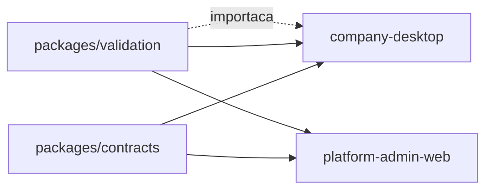

> Referência anterior à reorganização. As regras de produto podem continuar válidas, mas os caminhos e a divisão do código devem ser conferidos no `GUIA_DO_PROJETO.md` da raiz e no código atual.

# Integrações

Serviços externos e integrações internas. O sistema tem poucas dependências
externas de propósito: o backend inteiro é um único projeto Supabase.

---

## 1. Panorama

| Integração | Tipo | Obrigatória? |
|---|---|---|
| Supabase PostgreSQL | dados e regra de negócio | ✅ |
| Supabase GoTrue (Auth) | autenticação | ✅ |
| Supabase PostgREST | API do tenant | ✅ |
| Supabase Edge Functions | operações privilegiadas | ✅ |
| Relay SMTP | entrega de convite | opcional |
| Sistema operacional (Electron) | arquivos, chaveiro, tema | ✅ no Desktop |
| Câmera ESP32 / OCR | leitura de placa | **não integrada** — ver §7 |

Não há webhooks de entrada nem gateway de pagamento. Nenhum SDK de terceiros no
frontend.

---

## 2. Supabase — PostgreSQL e PostgREST

**Objetivo:** persistência e execução da regra de negócio.

**Comunicação:** HTTPS direto do cliente para `/rest/v1`, com `apikey` (chave
anônima) e `Authorization: Bearer <JWT>`.

**Autenticação e autorização:** a chave anônima identifica o projeto e **não
autoriza nada**. A autorização é a RLS, resolvida a partir do JWT.

**Dados enviados:** parâmetros de RPC (`p_*`) ou filtros PostgREST. Nunca
`company_id`.

**Dados recebidos:** `jsonb` em `camelCase` nas RPCs; linhas em `snake_case` nas
leituras diretas.

**Configuração:** `PNF_SUPABASE_URL`, `PNF_SUPABASE_ANON_KEY`.

**Erros:**

| Situação | Comportamento |
|---|---|
| `401` | `tryRefresh()` renova e repete uma vez; falhando, limpa a sessão |
| `PGRST202` (RPC ausente) | traduzido para `BACKEND_SCHEMA_OUTDATED` com mensagem específica: "o aplicativo está mais novo que o banco" |
| falha de transporte | `NETWORK_ERROR` + sondagem de saúde |
| erro com `HINT` | mensagem escolhida pelo código |

**Cuidados:**
- `max_rows = 1000` — o cliente pagina; teto de 50.000 linhas por consulta.
- Escrita direta só existe onde há grant **e** policy.
- Adicionar `private` ou `audit` a `db.schemas` expõe o modelo de segurança.

---

## 3. Supabase GoTrue (Auth)

**Objetivo:** autenticação por e-mail e senha.

**Endpoints usados:** ver [`API.md`](API.md#6-endpoints-gotrue-usados).

**Configuração relevante** (`supabase/config.toml` e painel do projeto):

| Item | Valor |
|---|---|
| `enable_signup` | `false` — sem cadastro público |
| `minimum_password_length` | `12` |
| `jwt_expiry` | `3600` |
| `enable_refresh_token_rotation` | `true` |
| `refresh_token_reuse_interval` | `10` |
| `enable_anonymous_sign_ins` | `false` |
| `secure_password_change` | `true` |
| `site_url` | origem do Admin Web |
| `additional_redirect_urls` | a origem e `<origem>/**` |

> **Armadilha conhecida:** o GoTrue **recusa silenciosamente** um `redirectTo`
> fora de `additional_redirect_urls` e envia a pessoa para `site_url` — sem o
> token de negócio na query. O convite abre uma tela que não sabe o que fazer, e
> o erro parece ser do link. Por isso `INVITE_BASE_URL` **precisa** estar na
> lista, e `ferramentas/verificacoes/verificar-configuracao.mjs` falha o build quando não está.

**Armazenamento de sessão:**

| Produto | Onde | Por quê |
|---|---|---|
| Desktop | arquivo cifrado com `safeStorage`, modo `0600` | chaveiro do sistema |
| Admin Web | `sessionStorage` | sessão administrativa não sobrevive ao fechamento da aba |

Se o chaveiro não estiver disponível, a sessão fica **efêmera** e o usuário é
avisado — não há degradação silenciosa para armazenamento em claro.

**Ponto de integração fora de transação:** `auth.admin.createUser` é HTTP contra
o GoTrue, fora do PostgreSQL. É a razão de todo o modelo de operação durável
([ADR-012](DECISOES_ATUAIS.md#decisao-012--primeiro-administrador-com-senha-direta)).

---

## 4. Edge Functions

Deno, com `@supabase/supabase-js`. Único lugar onde `service_role` existe.

### 4.1 `platform-admin`

| Item | Valor |
|---|---|
| Consumidor | Admin Web |
| `verify_jwt` | `true` (barreira do gateway) |
| Autorização | revalida `platform.is_platform_admin` **a cada chamada** |
| CORS | `ADMIN_WEB_ORIGINS` |
| Correlação | `x-request-id` |
| Negativas | registradas em `platform.log_denial` |

Ações em [`API.md`](API.md#5-edge-function-platform-admin).

### 4.2 `admin-users`

| Item | Valor |
|---|---|
| Consumidor | Desktop |
| `verify_jwt` | `true` |
| Autorização | `my_context()` + permissão da ação |
| CORS | `ADMIN_USERS_ALLOWED_ORIGINS` |
| Idempotência | `Idempotency-Key` + fingerprint SHA-256 do payload |

> **`ADMIN_USERS_ALLOWED_ORIGINS` precisa incluir `null`.** O renderer `file://`
> do Electron envia `Origin: null`. Sem isso, toda chamada de gestão de equipe
> falha com `ORIGIN_NOT_ALLOWED`.

**Varredura de usuários do Auth:** `buscarUsuarioAuthPorEmail` pagina
`listUsers` em 200 por página, até 100 páginas (20.000 contas). Além disso lança
`AUTH_USER_SCAN_EXHAUSTED`. É uma limitação da Admin API, não uma escolha.

**Segredos:** `SUPABASE_SERVICE_ROLE_KEY` é injetada pela plataforma Supabase.
**Não** deve ser adicionada manualmente.

---

## 5. Relay SMTP — entrega de convite

**Objetivo:** enviar o link de definição de senha.

**Comunicação:** `POST` para `SMTP_RELAY_URL` com
`{ from, to, subject, text }`, autenticado por `Authorization: Bearer
<SMTP_RELAY_TOKEN>` quando o token existe.

**Modos:**

| `INVITE_DELIVERY` | Comportamento |
|---|---|
| `log` | **não envia e-mail**; registra o link no log da função. Somente desenvolvimento. |
| `smtp` | envia pelo relay |

**Configuração:** `INVITE_DELIVERY`, `INVITE_BASE_URL`, `SMTP_RELAY_URL`,
`SMTP_RELAY_TOKEN`, `INVITE_FROM`, `INVITE_TTL_HOURS` (72),
`RESEND_COOLDOWN_SECONDS` (300).

**Erros:** sem `SMTP_RELAY_URL` configurada, ou relay respondendo erro, a função
devolve `invite_delivery_failed` (502) — não finge sucesso.

**Estado atual:** com o provisionamento por senha direta
([ADR-012](DECISOES_ATUAIS.md#decisao-012--primeiro-administrador-com-senha-direta)), **novas empresas
não recebem convite**. O caminho permanece para convites de equipe criados pelo
Desktop e para dados legados. A mesma `INVITE_BASE_URL` recebe os dois tipos de
link; o de equipe usa `?flow=team-invite`.

---

## 6. Sistema operacional (Electron)

Integração via IPC, com lista fechada de 11 canais.

| Canal | Uso | Restrição |
|---|---|---|
| `pnf:get-config` | endereço e chave pública | — |
| `pnf:get-app-info` | versão e plataforma | — |
| `pnf:get-theme` / `set-theme` | tema nativo | valores fechados |
| `pnf:window-state` | estado da janela | — |
| `pnf:export-save` | salvar relatório | CSV/JSON, ≤ 50 MB, nome saneado |
| `pnf:import-template-save` | salvar modelo oficial de importação | ID em whitelist; copia apenas `.xlsx` empacotado no app |
| `pnf:open-external` | abrir link | **só** `https:` e `mailto:` |
| `pnf:session-save/load/clear` | sessão cifrada | `safeStorage` |
| `pnf:config-status` | diagnóstico | usado na tela de configuração ausente |

**Permissões de mídia são sempre negadas** — `setPermissionRequestHandler`,
`setPermissionCheckHandler` e `setDevicePermissionHandler` retornam `false`. A
integração com câmera exigirá revisão explícita desse ponto.

**Rede bloqueada por padrão:** `onBeforeRequest` cancela toda requisição cujo
destino não seja `file:`, `devtools:`, `blob:`, `data:` ou a origem configurada
do Supabase. Uma URL nova exige mudar essa lista.

---

## 7. Câmera ESP32 / OCR — **não integrada**

Estado real, para evitar retrabalho.

**Pronto no banco, com testes:**

| Peça | Situação |
|---|---|
| `public.cameras` | ✅ com `min_confidence` |
| `public.plate_read_events` | ✅ |
| `register_plate_read(...)` | ✅ trata confiança, duplicidade e alternância |
| `confirm_plate_read(...)` | ✅ |
| `movement_source = 'ocr'` | ✅ exibido como "Câmera" na interface |
| permissões `cameras.*`, `ocr.*` | ✅ no banco |

**Falta:**

1. **O caminho de rede.** `register_plate_read` só aceita `authenticated`, e uma
   câmera não faz login. Levantamento (`../produto/CAMERA_ESP32_PRONTIDAO.md`)
   recomenda **Edge Function com chave de dispositivo**: a chave pertence à
   câmera, é revogável isoladamente, e a câmera nunca toca no banco.
   As alternativas foram avaliadas e rejeitadas — conta de serviço por empresa
   transforma a senha em credencial de usuário comum, e chave anônima direta na
   câmera não funcionaria nem seria aceitável.
2. **Decisão sobre a imagem.** Política atual: não armazenar. `image_reference`
   existe, mas Storage está desabilitado.
3. **Telas de gestão de câmera** — não existem.
4. **Worker OCR** — não existe nenhum código de worker, apesar de a documentação
   original descrever um.

**Cuidado ao implementar:** confiança mínima, deduplicação e decisão
entrada/saída **já estão resolvidas no servidor**. Reimplementar qualquer uma no
firmware cria duas fontes de verdade. A câmera não tem como saber o histórico do
veículo — e não deve tentar.

---

## 8. Integrações internas

### 8.1 Entre pacotes

Resolvidos por npm workspaces em desenvolvimento; **reescritos para caminhos
relativos pelos builds**, porque o navegador não resolve nome de pacote.

> O subcaminho `@peganafrota/validation/importacao` precisa ser reescrito
> **antes** do pacote base — o contrário deixaria um sufixo `/importacao` grudado
> no caminho já substituído.

### 8.2 Entre produtos

**Nenhuma.** Desktop e Admin Web não compartilham componentes, estilos ou
telas — apenas `packages/contracts` e `packages/validation` são compartilhados. Componentes e estilos permanecem separados; `ferramentas/verificacoes/verificar-fronteiras.mjs` verifica essa fronteira.

---

## 9. Configuração necessária

| Variável | Onde | Obrigatória |
|---|---|---|
| `PNF_SUPABASE_URL` | `.env` (build dos dois produtos) | ✅ |
| `PNF_SUPABASE_ANON_KEY` | `.env` | ✅ |
| `ADMIN_WEB_ORIGINS` | secret da Edge Function | ✅ |
| `ADMIN_USERS_ALLOWED_ORIGINS` | secret | ✅ (com `null`) |
| `INVITE_BASE_URL` | secret | ✅ se houver convite |
| `INVITE_DELIVERY` | secret | ✅ |
| `INVITE_TTL_HOURS` | secret | default 72 |
| `RESEND_COOLDOWN_SECONDS` | secret | default 300 |
| `INVITE_FROM` | secret | se `smtp` |
| `SMTP_RELAY_URL` / `SMTP_RELAY_TOKEN` | secret | se `smtp` |
| `SUPABASE_SERVICE_ROLE_KEY` | injetada pela plataforma | **nunca manualmente** |

Detalhes em [`IMPLANTACAO.md`](IMPLANTACAO.md).

---

## 10. Cuidados gerais

1. **`service_role` nunca sai da Edge Function.** Os builds falham ao encontrar a
   string no código do cliente.
2. **A chave anônima é pública** — mas continua fora do repositório, para não
   fixar ambiente no código.
3. **Origens precisam bater em três lugares:** `ADMIN_WEB_ORIGINS`,
   `INVITE_BASE_URL` e as Redirect URLs do Auth. `npm run test:config` verifica.
4. **CSP é gerada em build** a partir da origem do Supabase. Trocar de projeto
   exige recompilar.
5. **Sem CDN.** Toda dependência é local.
6. **Falha de integração nunca é silenciosa.** Convite não entregue devolve 502;
   RPC ausente devolve mensagem específica; sessão não persistida avisa.
