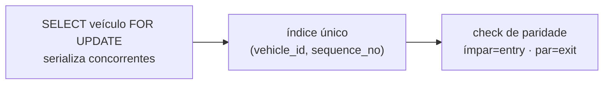

> Referência anterior à reorganização. As regras de produto podem continuar válidas, mas os caminhos e a divisão do código devem ser conferidos no `GUIA_DO_PROJETO.md` da raiz e no código atual.

# Regras de negócio

Cada regra com **onde é imposta**. A coluna "Onde" é o que importa: uma regra
imposta apenas na interface é uma sugestão; uma imposta por constraint é uma
garantia.

Convenção de força, do mais forte para o mais fraco:

| Nível | Significado |
|---|---|
| **constraint / índice** | impossível violar por qualquer caminho |
| **grant ausente** | o verbo SQL não existe para o cliente |
| **trigger** | validado a cada escrita, inclusive fora da RPC |
| **RPC** | validado no único caminho de escrita permitido |
| **policy RLS** | filtra linhas alcançáveis |
| **Edge Function** | validado no canal privilegiado |
| **cliente** | conveniência de interface, **nunca** garantia |

---

## 1. Quilometragem

### 1.1 A quilometragem nunca regride
`private.record_odometer_event` compara com `current_odometer_km` sob lock e
lança `ODOMETER_REGRESSION`. Reforçado pela constraint
`odometer_events_no_backward` (`odometer_km >= previous_km`).
**RPC + constraint** · `migrations/20260729001300`, `..._000500`

### 1.2 `current_odometer_km` é cache, nunca campo editável
Trigger `tg_vehicle_odometer_guard` bloqueia qualquer escrita direta. Só a
função `SECURITY DEFINER` consegue atualizar.
**trigger** · `migrations/20260729000900`

### 1.3 Todo evento registra a origem
`source_type` é enum de cinco valores. `source_id` é obrigatório exceto em
cadastro e ajuste manual (`odometer_events_source_id_required`).
**constraint** · `migrations/20260729000500`

### 1.4 O ledger é imutável
`UPDATE` e `DELETE` bloqueados por trigger; nenhum grant de escrita para
`authenticated`.
**trigger + grant ausente**

### 1.5 Ajuste manual exige justificativa e permissão própria
`register_odometer_reading` exige `odometer.adjust` e motivo não vazio.
Constraint `odometer_events_manual_needs_reason` garante no banco.
**RPC + constraint**

### 1.6 Retrodatar só como correção explícita
Evento comum exige `occurred_at >= occurred_at` do último evento do veículo.
Retrodatação só com `correction_of_id` + motivo — o que já exige
`odometer.adjust`. A monotonicidade por `(occurred_at, created_at)` é invariante
verificada pelo autoteste de integridade.
**trigger** · `migrations/20260731000600`

### 1.7 Correção nunca reduz a quilometragem
Correção é append-only no presente: cria evento novo, não altera o anterior.
**RPC** · `migrations/20260731000900`

### 1.8 Quatro operações sempre geram evento
Cadastro de veículo, conclusão de viagem, abastecimento e conclusão de
manutenção. O índice único `(source_type, source_id)` impede duplicar o evento
da mesma fonte.
**RPC + índice único**

---

## 2. Movimentações de pátio

### 2.1 A primeira movimentação é sempre entrada
`constraint movements_first_is_entry: sequence_no > 1 or movement_type = 'entry'`
**constraint**

### 2.2 Entrada e saída alternam obrigatoriamente
Três camadas independentes:



Mesmo que as duas primeiras falhassem, a terceira torna impossível gravar torto.
Corrida perdida devolve `CONFLICT_RETRY`.
**RPC + índice único + constraint** · `migrations/20260729001700`

### 2.3 Deduplicação por janela
Mesmo veículo, mesmo local, mesma origem, dentro da janela (default 90 s, teto
3600 s) → devolve a movimentação anterior com `deduplicated: true`.

Duas proteções sutis, ambas encontradas por teste de concorrência real:

- `v_window > interval '0'` — janela zero significa "não deduplicar";
- `greatest(now() - occurred_at, interval '0')` — `now()` é o instante de
  **início** da transação. Numa rajada simultânea, a transação que perde o lock
  tem `now()` **anterior** ao `occurred_at` já gravado, e o intervalo fica
  negativo. Sem o `greatest`, qualquer intervalo negativo era menor que a janela
  e deduplicava indevidamente.

**RPC**

### 2.4 O horário é sempre do servidor
`occurred_at` recebe `now()` dentro da RPC. O cliente não consegue backdatar.
**RPC**

### 2.5 Veículo arquivado ou local inativo não movimenta
`CONFLICT_ARCHIVED` e `LOCATION_INACTIVE`.
**RPC**

### 2.6 Uma leitura OCR gera no máximo uma movimentação
Índice único `movements_plate_read_unique_idx`.
**índice único**

---

## 3. OCR e câmeras

### 3.1 Leitura abaixo do limiar não gera movimentação
Status `low_confidence`, pendente de confirmação manual.
**RPC**

### 3.2 O limiar é configuração do servidor
`cameras.min_confidence` (default `0.80`, faixa `0.50`–`1.00`). O limiar efetivo
é `greatest(camera.min_confidence, p_min_confidence)`: o cliente pode ser **mais**
rigoroso, nunca menos. Antes desta correção o operador controlava o limiar.
**RPC + constraint** · `migrations/20260731000300`

### 3.3 Placa desconhecida é guardada, não descartada
Status `unknown_plate`, sem veículo associado
(`plate_read_unknown_has_no_vehicle`). Resolvida depois por
`confirm_plate_read`.
**RPC + constraint**

### 3.4 Só leitura confirmada origina movimentação
`plate_read_confirmed_requires_vehicle` e validação em
`register_vehicle_movement`.
**constraint + RPC**

### 3.5 Câmera não guarda credencial
`cameras_settings_no_secrets` recusa 11 chaves conhecidas em `settings`.
**constraint**

---

## 4. Viagens

| # | Regra | Onde |
|---|---|---|
| 4.1 | Só viagem `planned` pode ser iniciada | RPC + trigger `tg_trip_status_guard` |
| 4.2 | Só viagem `in_progress` pode ser concluída | RPC + trigger |
| 4.3 | Km final **maior** que o inicial | RPC + `trips_odometer_progress` |
| 4.4 | Retorno não antecede a saída | RPC + `trips_actual_window` |
| 4.5 | Data de execução não fica no futuro (tolerância de 5 min) | RPC |
| 4.6 | Veículo arquivado, inativo ou em manutenção não inicia viagem | RPC |
| 4.7 | Um veículo, no máximo uma viagem em andamento | índice único parcial |
| 4.8 | Cancelamento exige motivo | RPC + `trips_status_cancelled` |
| 4.9 | Cancelar limpa datas reais e quilometragens | RPC |
| 4.10 | Coerência de campos por estado | 4 constraints `trips_status_*` |
| 4.11 | Viagem criada nasce `planned` | policy de INSERT |

---

## 5. Abastecimentos

### 5.1 Total exato, sempre
```sql
constraint fuelings_total_exact
  check (total_amount = round(liters * price_per_liter, 2))
```
Se o cliente enviar total divergente, a RPC recusa com `FUELING_TOTAL_MISMATCH`
antes mesmo da constraint.
**constraint + RPC**

### 5.2 Nunca ponto flutuante
`money_brl numeric(14,2)`, `liters numeric(12,3)`, `price_per_liter
numeric(10,3)`. No cliente, `calcularTotalAbastecimento()` trabalha em inteiros
(milésimos) e arredonda no fim, para exibir o mesmo número que o banco gravará.
**domain + cliente**

### 5.3 Combustível compatível
| Veículo | Aceita |
|---|---|
| `flex` | gasolina, etanol, GNV |
| `gasoline` | gasolina, GNV |
| `ethanol` | etanol |
| `diesel_s10` / `diesel_s500` | ambos os diesel |
| `cng` | GNV, gasolina |
| `electric` | **nada** |

`flex` e `electric` descrevem **motorização**, não produto de bomba.
**trigger** (`private.fuel_is_compatible`) · `migrations/20260731000700`

### 5.4 Abastecimento só por RPC
Sem grant de `INSERT` para `authenticated`.
**grant ausente**

### 5.5 Campos centrais são imutáveis após gravação
`tg_fueling_core_immutable`.
**trigger**

### 5.6 Consumo médio só de tanque cheio
`v_vehicle_fuel_consumption` considera apenas ciclos `full_tank`. Misturar
abastecimentos parciais produz média sem significado.
**view** · `migrations/20260731000700`

---

## 6. Manutenções

| # | Regra | Onde |
|---|---|---|
| 6.1 | Agendar exige `maintenance.schedule`; registrar em andamento exige `maintenance.write` | policy de INSERT |
| 6.2 | Data futura só em `scheduled` | trigger `tg_maintenance_chronology` |
| 6.3 | Concluída exige `total_cost > 0` | `maintenance_status_completed` |
| 6.4 | Um veículo, no máximo uma manutenção em andamento | índice único parcial |
| 6.5 | `start_maintenance` exige veículo efetivamente disponível | RPC |
| 6.6 | Conclusão/cancelamento não liberam o veículo se houver outra manutenção aberta | RPC |
| 6.7 | Conclusão com quilometragem gera evento de odômetro | RPC |
| 6.8 | Cancelamento exige motivo | RPC + constraint |
| 6.9 | Arquivamento só de `completed` ou `cancelled` | `maintenance_archive_consistent` |

---

## 7. Cadastros

### 7.1 CNPJ único globalmente e válido
`companies_cnpj_unique` + `companies_cnpj_valid` com módulo 11
(`private.is_valid_cnpj`). Normalizado por trigger **antes** do check — por isso
CNPJ usa `text` + `CHECK`, não `domain`.
**constraint + trigger**

### 7.2 Placa única globalmente
`vehicles_plate_unique`. Formato `AAA0000` (antiga) ou `AAA0A00` (Mercosul),
normalizado por trigger.
**constraint + trigger**

### 7.3 Arquivar em vez de excluir
Veículos, motoristas, locais e manutenções usam `archived_at`. Viagens e
manutenções usam cancelamento. FKs `on delete restrict` impedem exclusão de
qualquer coisa com histórico.
**ausência de policy DELETE + FK** · [ADR-005](../adr/ADR-005-archive-instead-of-delete.md)

### 7.4 Veículo com viagem aberta não pode ser arquivado
`VEHICLE_HAS_OPEN_TRIPS`. A interface abre um atalho para as viagens.
**RPC**

### 7.5 Veículo nasce disponível ou inativo
Nunca em uso, em manutenção ou arquivado.
**policy de INSERT + trigger**

### 7.6 Unicidade parcial
Documento interno de motorista e nome de local são únicos por empresa **entre os
não arquivados** — arquivar libera o valor para reuso.
**índice único parcial**

### 7.7 Ator sempre pertence à empresa da linha
`created_by`, `cancelled_by`, `archived_by` e `operator_user_id` são validados
contra a empresa do registro; o servidor carimba `created_by` em toda escrita
direta. Uma FK simples prova que o UUID existe, não que pertence à empresa.
**trigger** · `migrations/20260731000500`

---

## 8. Identidade e acesso

### 8.1 Um usuário, um vínculo ativo
Índice único parcial `(user_id) WHERE active`.
**índice único** · [ADR-004](../adr/ADR-004-single-company-membership.md)

### 8.2 Três estados precisam estar ativos
`private.current_membership()` exige `membership.active`, `profile.active` **e**
`company.status = 'active'`. Qualquer um falso devolve `NULL`, e
`company_id = NULL` nunca satisfaz policy alguma.
**função + policy**

### 8.3 Suspender a empresa remove o acesso de todos
Consequência direta de 8.2, sem alterar vínculo algum.
**função**

### 8.4 A empresa nunca fica sem administrador ativo
`tg_protect_last_admin` e `tg_protect_last_admin_profile`, com
`private.count_effective_admins` e `lock_company_admin_gate` para evitar corrida
entre duas desativações simultâneas. `LAST_ADMIN_PROTECTED`.
**trigger** · `migrations/20260731000100`

### 8.5 A plataforma nunca fica sem administrador ativo
`platform.tg_protect_last_platform_admin`, ativo inclusive em delete em cascata.
`LAST_PLATFORM_ADMIN_PROTECTED`.
**trigger**

### 8.6 Ninguém desativa a si mesmo
`CANNOT_DEACTIVATE_SELF` / `CANNOT_BLOCK_SELF`.
**RPC + Edge Function**

### 8.7 A empresa não administra o estado global do perfil
Desde `20260731000100`, o usuário só altera `full_name` e `phone` do próprio
perfil — por **grant de coluna**. Nenhum bug de policy reabre o caminho, porque o
verbo não existe para as demais colunas. `profiles.active` é privilegiado.
**grant de coluna**

### 8.8 Conta suspensa na plataforma não é reativada pela empresa
`PROFILE_GLOBALLY_INACTIVE`.
**Edge Function**

### 8.9 Dois eixos independentes
`platform.admins.status` (conta global) e `company_memberships.active` (acesso a
uma empresa) **nunca são fundidos**.
**modelo** · [ADR-011](DECISOES_ATUAIS.md#decisao-011--camada-de-plataforma-e-dois-eixos-de-identidade)

### 8.10 Senha mínima de 12 caracteres
`config.toml`, `packages/validation` e as duas Edge Functions. Recusa espaços
apenas e caractere único repetido. Máximo de 72.
**configuração + Edge Function + cliente**

### 8.11 Sem cadastro público
`enable_signup = false`. Contas só nascem por Edge Function administrativa.
**configuração**

---

## 9. Plataforma

### 9.1 Idempotência em duas camadas
`idempotency_key` única **e** `fingerprint` SHA-256 do payload. Mesma chave com
payload diferente é **erro** (`IDEMPOTENCY_REUSE`), não replay — sem isso,
reusar a chave por engano devolveria silenciosamente a empresa errada.
**índice único + RPC**

### 9.2 `retryable` é autoridade do backend
A interface apenas habilita ou não o botão. Constraint garante que só `failed` e
`compensated` podem ser retentáveis.
**constraint**

### 9.3 Ação destrutiva exige confirmação pelo nome
`CONFIRMATION_MISMATCH`. A comparação normaliza espaços e caixa
(`nomeConfirmacaoConfere`). Sair da aplicação usa confirmação **simples** — pedir
o nome ali seria atrito sem proteção, e treinaria a pessoa a ignorar a
confirmação que importa.
**RPC + cliente**

### 9.4 Exclusão definitiva é o segundo passo
Só empresa **arquivada** pode ser excluída. Remove dados operacionais e a
auditoria do tenant; a trilha global é preservada, mas payloads são saneados
para não manter cadastro operacional apagado.
**RPC** · `migrations/20260812000200`

### 9.5 Compensação arquiva, não exclui
Provisionamento compensado arquiva a empresa. Auditoria preservada.
**RPC**

### 9.6 E-mail já existente é recusado no provisionamento
`auth_email_conflict`. Evita que o administrador redefina, sem perceber,
credenciais usadas por outra pessoa.
**Edge Function**

### 9.7 Autoria histórica é preservada
`platform.operations.actor_user_id` aceita `NULL` com `ON DELETE SET NULL`;
`platform.audit_events.actor_user_id` guarda o UUID **sem FK**, porque uma FK
tentaria `UPDATE` numa trilha append-only.
**modelo** · `migrations/20260808000100`

### 9.8 Bootstrap só sem administrador ativo
`BOOTSTRAP_NOT_AVAILABLE`. Token efêmero, de uso único, com expiração.
**RPC**

### 9.9 Substituição ativa o novo antes de remover o anterior
Preserva `LAST_PLATFORM_ADMIN_PROTECTED` sem criar janela sem administrador.
**RPC transacional**

### 9.10 Reenvio de convite tem intervalo mínimo
`RESEND_COOLDOWN_SECONDS` (default 300) → `429` + `Retry-After`.
**Edge Function**

### 9.11 Motivo de suspensão é vocabulário fechado
Quatro valores: solicitação do cliente, violação contratual, risco de segurança,
cadastro em revisão. Sem cobrança ou planos.
**enum**

---

## 10. Auditoria

| # | Regra | Onde |
|---|---|---|
| 10.1 | Append-only para todos os papéis, inclusive o dono | trigger `tg_forbid_mutation` |
| 10.2 | Registra apenas campos alterados, `{campo:{old,new}}` | trigger `tg_audit` |
| 10.3 | Ignora `updated_at`, `created_at`, `last_seen_at` | função `audit_ignored_columns` |
| 10.4 | Não polui a trilha quando só houve ruído de timestamp | trigger |
| 10.5 | Arquivamento tem ação própria (`archive`/`unarchive`) | trigger |
| 10.6 | Escrita só por `private.log_audit_event` | ausência de policy |
| 10.7 | Leitura exige `audit.read` e é limitada à empresa | policy |
| 10.8 | A auditoria global registra também as **negativas** | `platform.log_denial` |
| 10.9 | Senha nunca entra em payload persistido | Edge Function |
| 10.10 | A auditoria administrativa **é** o registro de idempotência | `migrations/20260731000800` |

---

## 11. Importação em massa

| # | Regra | Onde |
|---|---|---|
| 11.1 | Aceita `.xlsx`, CSV e células copiadas; XLSX é lido localmente | `importacao.mjs` + `planilha.mjs` |
| 11.2 | Sempre com prévia, sem gravar nada | cliente |
| 11.3 | Linha a linha — uma linha ruim não derruba as outras | cliente |
| 11.4 | O erro informa o **número da linha na planilha** (`i + 2`) | cliente |
| 11.5 | Separador detectado automaticamente (`;`, `,`, tab) | cliente |
| 11.6 | Formatos brasileiros: `1.234,56`, `31/12/2028` | cliente |
| 11.7 | BOM do Excel removido | cliente |
| 11.8 | Cabeçalho tolerante: sem acento, sem pontuação, minúsculo | cliente |
| 11.9 | Aspas com separador dentro são preservadas | cliente |
| 11.10 | Cada linha passa pelo mesmo validador da tela | cliente |
| 11.11 | Toda linha é gravada pela RPC normal — **nenhum atalho** | RPC |

> Um teste pegou um defeito real: `"abc"` virava `0` após a limpeza numérica, e
> um odômetro zerado entraria como valor válido.

---

## 12. Interface

| # | Regra | Onde |
|---|---|---|
| 12.1 | Ação sem permissão fica **desabilitada com motivo**, não oculta | `aplicarPermissao()` |
| 12.2 | Item de menu pode ser ocultado por papel; a ação da tela, não | `NAV` |
| 12.3 | Permissões são revalidadas no `focus` da janela | `main.mjs` |
| 12.4 | Resultado de tela abandonada é descartado | `__pnfLoadToken` |
| 12.5 | Sair pede confirmação nos dois produtos | `confirmAction` |
| 12.6 | Exibir senha preserva a posição do cursor | login |
| 12.7 | Sessão não persistida avisa o usuário | `sessao.isEphemeral` |
| 12.8 | Banner de conectividade não bloqueia ações | shell |
| 12.9 | Exportação limitada a CSV/JSON e 50 MB | `main.cjs` |
| 12.10 | Nome de arquivo exportado é saneado | `main.cjs` |

---

## 13. Comportamentos que parecem estranhos, mas são intencionais

1. **`my_context()` devolve erro como dado.** Ausência de vínculo é um estado
   normal, não uma exceção — permite a tela específica.
2. **Os nomes de canal IPC são duplicados** entre `preload.cjs` e
   `ipc-channels.cjs`. O preload sandboxed não pode fazer `require()` local. Um
   verificador confere o sincronismo.
3. **`platform` é endereçável pelo PostgREST.** A segurança não vem da
   invisibilidade: sem `USAGE` e sem `EXECUTE`, o endereço não leva a nada.
4. **`company_id` é redundante em toda tabela.** Torna a RLS direta, melhora
   índices e permite validar coerência entre relacionamentos.
5. **Toda tabela tem `company_id`, mas nenhuma RPC o aceita como parâmetro.**
   Aceitar tornaria a RLS decorativa.
6. **`private.is_api_role()` é `SECURITY INVOKER`** enquanto todo o resto é
   `DEFINER`. Ela precisa enxergar o papel do **chamador**.
7. **Helpers RLS são embrulhados em `(select ...)`.** Vira InitPlan e é avaliado
   uma vez por consulta, não por linha.
8. **CNPJ e placa não usam `domain`.** Domain é validado antes do trigger de
   normalização, o que tornaria a normalização inútil.
9. **`navigator.onLine` foi abandonado.** Gerava falso positivo de offline no
   Windows/Electron ([ADR-015](DECISOES_ATUAIS.md#decisao-015--conectividade-por-sondagem-de-saude)).
10. **A etapa `send_invite` existe e é marcada como `skipped`.** Mantida por
    compatibilidade com o modelo de operações
    ([ADR-012](DECISOES_ATUAIS.md#decisao-012--primeiro-administrador-com-senha-direta)).
11. **O log de histórico saiu do Desktop, mas a auditoria continua sendo
    gravada.** O que saiu foi a tela — uma lista técnica que o operador de frota
    não interpreta e que competia por atenção. A consulta continua possível.
